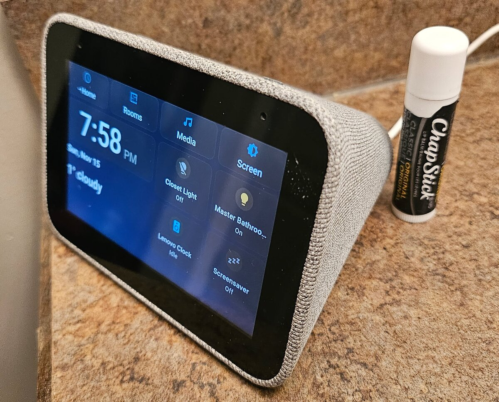
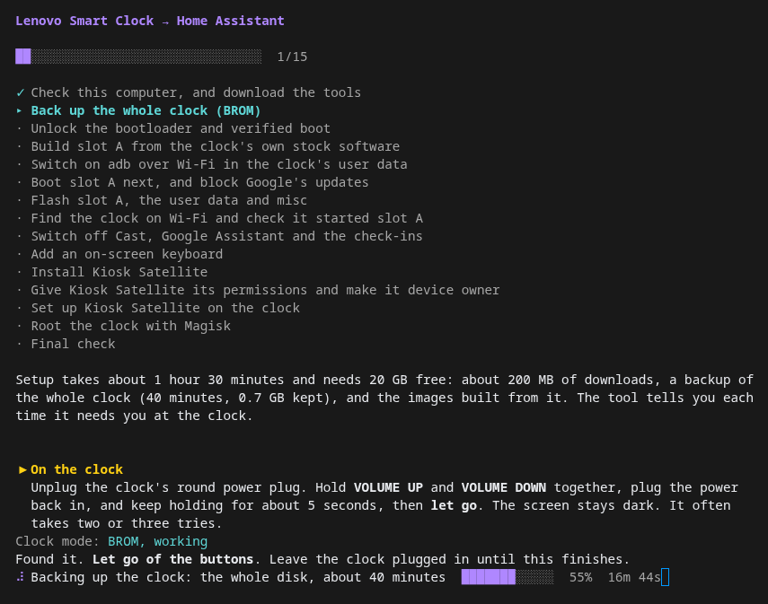
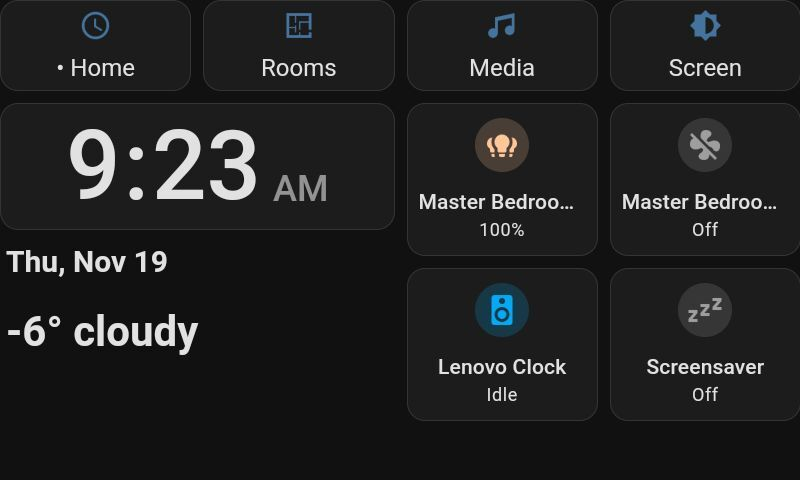

# lenovo-clock-ha-kiosk



**Turn a stock Lenovo Smart Clock (gen 1) into a degoogled Home Assistant kiosk: your dashboard on its 4" screen,
with Music Assistant, and root.**

Lenovo's Smart Clock stopped getting updates, and Google keeps removing its features. Its clock also drifts wrong
whenever a region changes its daylight saving rules. The hardware is still good: a 4" touchscreen, two mics, a
speaker, a light sensor and Wi-Fi.

This tool keeps the clock's own Android Things 8.1 and adds
[Kiosk Satellite](https://github.com/jxlarrea/kiosk-satellite), which runs your
[Home Assistant](https://www.home-assistant.io/) dashboard and plays music from
[Music Assistant](https://music-assistant.io/). Google Assistant, Cast, the phone-home check-ins and Google's
updates are switched off. It's the clock's sibling of
[lenovo-display-ha-kiosk](https://github.com/TRusselo/lenovo-display-ha-kiosk), which does the same for the
Smart Display 8, and it looks and works the same way.

> [!CAUTION]
> **Vibecoded, unaudited, your risk, and early.** The code, notes and docs were written by an AI (Claude) in
> conversation with the author, and tested on one clock, through seven end-to-end runs. It unlocks the bootloader and rewrites partitions, so
> **it can brick the clock.** The tool makes a full backup first and won't go on without one. No warranty, no
> support.

## Clocks

|    | Clock | Model | Status |
|----|-------|-------|--------|
| ⚠️ | Lenovo Smart Clock (gen 1) | CD-24501F | **Early.** Tested on one clock, stock to kiosk dozens of times. [Device notes](devices/cube/README.md) |
| ❌ | Lenovo Smart Clock 2 | CD-24502F | **Not supported.** Android 10, different firmware. Kiosk Satellite has its own notes for it |
| ❌ | Lenovo Smart Clock Essential | CD-24503F | **Not supported.** No touchscreen |

The tool checks the model over Wi-Fi before it changes anything there, and refuses anything but the gen 1.

## What you get

| | Stock | After |
|---|---|---|
| Screen | Google's clock face | Your Home Assistant dashboard, with [one made for this screen](https://github.com/TRusselo/lenovo-clock-dashboard) (HACS) |
| Assistant | Google, in the cloud | Off. Home Assistant voice is planned, not yet tested |
| Music | Cast | Music Assistant (Sendspin), volume buttons work |
| Clock | Wrong after DST rule changes | Right, with a fixed-offset zone ([how](docs/TIMEZONES.md)) |
| Brightness | Automatic | Automatic (light sensor) |
| Keyboard | None | Simple Keyboard, for typing on the screen |
| Root | No | Magisk |
| Updates | Google's | Blocked; Kiosk Satellite updates itself |
| Google | Everything | Off: Assistant, Cast, check-ins |

## What you need

- The clock, and its round barrel-plug power supply: the clock runs on that, not on USB
- A **USB A-to-A cable**: a plug like the computer end of a normal USB cable at *both* ends, wired straight
  through, with no chip in the middle (not a "data transfer" or "bridge" cable). USB 2 or USB 3 both work
  ([what it looks like](docs/GUIDE.md#the-usb-cable))
- A Windows, macOS or Linux computer with about 20 GB free
- Your Wi-Fi: the clock booted and connected to it (set it up with the Google Home app), or your Wi-Fi name
  and password to type into the tool. The first thing it asks is which
- Home Assistant
- About an hour and a quarter; most of it is waiting (the backup alone is about 35 minutes)

## Quick start

You don't need a GitHub account, and you don't need to know any code. You'll type one command.

**1. Download the program for your computer.** One click; it's always the newest version.

| Your computer | Download |
|---|---|
| Windows 10 or 11 | [lck-windows-x86_64.zip](https://github.com/TRusselo/lenovo-clock-ha-kiosk/releases/latest/download/lck-windows-x86_64.zip) |
| Mac with an M1 chip or newer | [lck-macos-arm64.zip](https://github.com/TRusselo/lenovo-clock-ha-kiosk/releases/latest/download/lck-macos-arm64.zip) |
| Linux PC | [lck-linux-x86_64.zip](https://github.com/TRusselo/lenovo-clock-ha-kiosk/releases/latest/download/lck-linux-x86_64.zip) |

**2. Unzip it** into a folder of its own. Your downloads and the clock's backup will be saved there too.

**3. Open a terminal in that folder.** A terminal is the text window where you type commands:
- **Windows:** open the folder, click the address bar at the top, type `cmd`, press Enter.
- **Mac:** open Terminal, type `cd ` (with a space), drag the folder onto the window, press Return.
- **Linux:** right-click in the folder and choose **Open Terminal Here**.

**4. Type the command** and press Enter:
- Windows: `lck\lck setup`
- Mac: `xattr -dr com.apple.quarantine lck` first, then `./lck/lck setup`. The first command stops macOS
  blocking the program ([more](docs/MACOS.md#if-macos-blocks-the-program)).
- Linux: `./lck/lck setup`

**5. Do what it says.** It tells you each time it needs you: which buttons to hold on the clock, what to set up on
its screen, and when to press Enter. That's it. If it stops for any reason, type the same command again and it
carries on where it left off.



Yellow means it's your turn: something to do on the clock, or a question to answer. Red only shows when something
went wrong.

Each system has a one-time extra step: USB drivers on Windows, Homebrew's libusb on a Mac, a USB permission on
Linux. Everything else comes in the zip. The full guides walk you through it:
[Windows](docs/WINDOWS.md) · [Mac](docs/MACOS.md) · [Linux](docs/LINUX.md). Every page, in the order you'll need
them: [the guide](docs/GUIDE.md).

> [!NOTE]
> Tested end to end on **Linux**, on one clock, seven times. The Windows and Mac programs are new and haven't
> converted a real clock yet: on those systems, USB (BROM mode and fastboot) is untested. If you try one, please
> say how it went, whether it worked or not.

### Words you'll see

- **Terminal:** the text window where you type the command.
- **BROM mode and fastboot mode:** special ways the clock can start, for backing up and installing. You get to them
  by holding volume buttons while plugging in the power; the tool tells you which ones. **The screen stays dark in
  both**, which is normal. If you see the clock face, it started normally instead: unplug and try again.
- **Slot A and slot B:** the clock has two copies of its system. The tool puts the clock's own stock software on
  slot A and leaves slot B alone, as a fallback.
- **adb over Wi-Fi:** how the tool talks to the clock once Android is running. The clock's USB port can't do it.
- **The backup:** a copy of the clock's whole disk, saved as one zip file. The setup is built from it, and it's
  the only way back, so keep it safe.

### Questions, problems, or it worked?

[Open an issue](../../issues), or ask in the Smart Display project's
[Home Assistant Community thread](https://community.home-assistant.io/t/lenovo-smart-display-8-as-a-de-googled-ha-dashboard-running-kiosk-satellite-w-assist-working-testers-wanted/1033810).
Say how far it got, and copy the last few lines the tool printed.

### For tinkerers

Run it from source with your own Python 3.10+: [docs/PYTHON.md](docs/PYTHON.md). Do every step by hand, or point an AI agent at it: [devices/cube/README.md](devices/cube/README.md) has each step
with the check that proves it worked (agents: start with [AGENTS.md](AGENTS.md)). What was learned about the clock,
observed versus guessed: [docs/findings/NOTES.md](docs/findings/NOTES.md).

## Extra: a dashboard made for the clock

[Lenovo Clock Dashboard](https://github.com/TRusselo/lenovo-clock-dashboard) is a Home Assistant dashboard sized for the clock's 4" screen: a big clock with
the next alarm and weather, your rooms, the clock's music player, and screen controls. It finds the clock by
itself and uses built-in cards only. It's optional: the clock shows any dashboard you pick.



More views and screenshots: [the dashboard's repository](https://github.com/TRusselo/lenovo-clock-dashboard).

[](https://my.home-assistant.io/redirect/marketplace_repository/?owner=TRusselo&repository=lenovo-clock-dashboard&category=plugin)

**Quick start:**
1. Click the button above. It opens the dashboard in the Marketplace (Home Assistant 2026.11 and later) or HACS
   (older versions). Choose **Download**, then reload your browser.
2. In Home Assistant, go to **Settings > Dashboards > Add dashboard** and pick **Kiosk Clock**. If it isn't
   offered, make an empty dashboard, open **⋮ > Edit dashboard > ⋮ > Raw configuration editor**, and replace
   everything with:

   ```yaml
   strategy:
     type: custom:kiosk-clock
   ```

3. In Kiosk Satellite on the clock, pick the new dashboard.

Options, installing by hand, and questions about the dashboard: [its own repository](https://github.com/TRusselo/lenovo-clock-dashboard).

## How it works

Unlike the Smart Display, there's no leaked debug build for the clock, and its USB port can't do adb under
Android. So the tool:
- **downloads everything it needs from the original sources** and checks each file against a pinned checksum;
- **backs up the whole clock first**, in BROM mode, with [mtkclient](https://github.com/bkerler/mtkclient);
- **unlocks the bootloader and verified boot**, which wipes the clock's user data;
- **rebuilds slot A from the backup:** the clock's own stock software, and its own user data, edited on the
  computer so adb over Wi-Fi comes up with your computer's key, and Google's updates pointed nowhere;
- **finishes over Wi-Fi:** root with Magisk, then Google off (hiding Cast for good needs root), a keyboard, and
  Kiosk Satellite;
- **tells you exactly which buttons to hold, and when to let go.** The screen stays dark in those modes, so the
  tool shows which mode the clock is in;
- **waits as long as you need,** and when the clock drops out during a step over Wi-Fi, waits for it and does that
  step again;
- **can stop and pick up again.** Run the same command again to continue where it stopped.

Your Wi-Fi comes back from the backup (or the tool adds the one you type, which it never logs), and the Home
Assistant sign-in is done **on the clock itself** or in a browser at an address the tool shows you.

**To make another backup** at any time, in the same folder: `lck\lck backup --name clock-later` on Windows, or
`./lck/lck backup --name clock-later` on Mac and Linux.
**To go back** to a backup: `lck\lck restore backup\clock.zip` on Windows, or `./lck/lck restore backup/clock.zip`
on Mac and Linux. It checks the
backup is from this clock, then writes it back in BROM mode. It takes about 20 minutes. A backup only restores to
the clock it came from. The bootloader stays unlocked; stock starts fine that way. **Never use the clock's own
factory reset to go back:** done while online, it unlinks the clock from your Google account, which no restore can
undo.

## Credits

> [!IMPORTANT]
> **This is built on other people's work.**
> - **kortregt:** [lenovo-smart-clock-linux](https://github.com/kortregt/lenovo-smart-clock-linux): the unlock and
>   backup procedure, and the hardware notes.
> - **joserodpt:** [lenovo-cd24501f-research](https://github.com/joserodpt/lenovo-cd24501f-research): offline
>   userdata provisioning with `debugfs`.
> - **deadman96385:** the AVB unlock credentials, kernel source and firmware dump.
> - **untocodes:** [lenovo-cube-hacking](https://github.com/untocodes/lenovo-cube-hacking) notes (UART, USB, AVB).
> - **S7ruc7ureV01d:** [lenovo-smart-clock-lineage](https://github.com/S7ruc7ureV01d/lenovo-smart-clock-lineage):
>   the LK fastboot workaround (`fbmulti.py`, `sparsesplit.py`) and the boot-chain findings.
> - **bkerler:** [mtkclient](https://github.com/bkerler/mtkclient).
> - **topjohnwu:** [Magisk](https://github.com/topjohnwu/Magisk).
> - **rkkr:** [Simple Keyboard](https://github.com/rkkr/simple-keyboard).
> - **jxlarrea:** [Kiosk Satellite](https://github.com/jxlarrea/kiosk-satellite).
>
> This repo doesn't host firmware, credentials or third-party tools. The tool downloads them at run time from their
> own sources; [`manifest.json`](manifest.json) pins each one.

## Licence

MIT, for this repository's own code and docs ([LICENSE](LICENSE)). Downloaded components keep their own terms.
