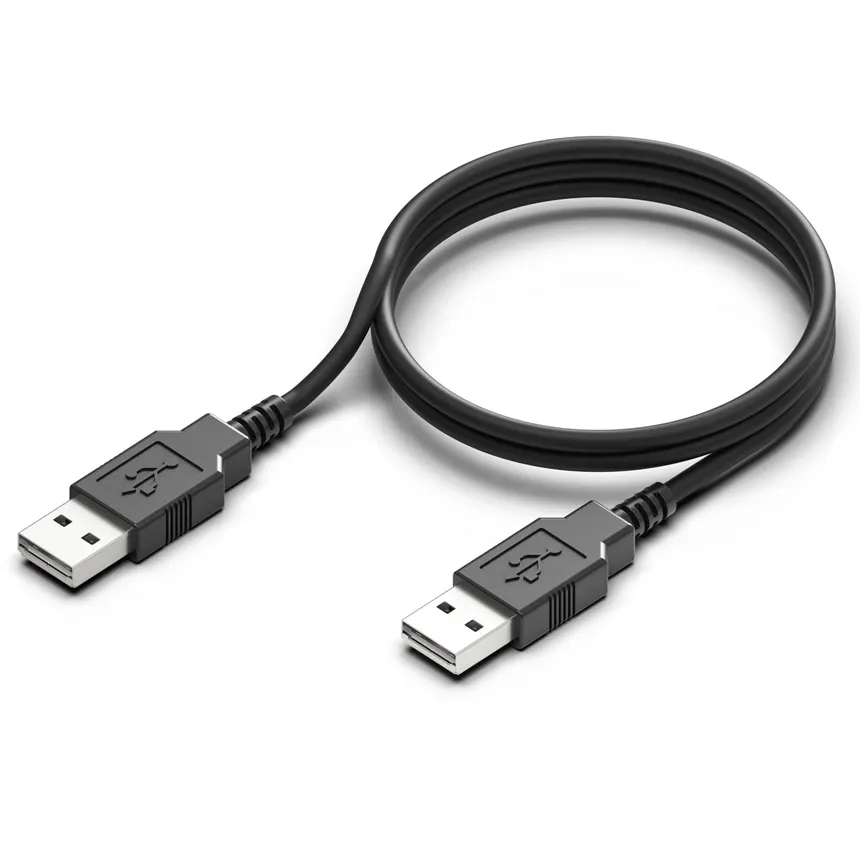

# Guide

Every page in one place, in the order you'll need them.

## How setup goes

```text
 Your computer                     The clock
 -------------                     ---------
 1. Get the tool, Linux guide
 2. Run: lck setup
       |
       |-- backup -------------->  BROM mode (screen dark)
       |-- unlock -------------->  fastboot mode (screen dark)
       |-- build slot A from the backup
       |-- flash --------------->  fastboot mode (screen dark)
       |                           starts stock Android Things, joins your Wi-Fi
       |-- you: the clock's address
       |-- root ---------------->  fastboot mode, then you: Magisk
       |-- Google off, keyboard, Kiosk Satellite (over Wi-Fi)
       |                           you: Kiosk Satellite setup
       |-- final check
       v
 3. Keep the backup zip            Home Assistant dashboard
```

The tool tells you each time it needs you at the clock. The screen stays dark in BROM and fastboot modes:
that's normal.

## What you'll see

One screen that redraws as setup goes: a bar, every step with a ✓ when it's done, and the current one
highlighted. Under it, the job in progress counts up, such as "37%" for the backup.

- **Yellow is your turn.** An "On the clock" box says what to do there, with the buttons in bold. A yellow
  question waits for you to type or press Enter.
- **Clock mode** shows which mode the clock is in while the tool waits for it. It keeps waiting as long as you
  need, so you can walk away: press Ctrl-C to stop.
- **If the clock drops out** during a step over Wi-Fi (it restarted, or lost power or Wi-Fi), the tool says so,
  waits for it to come back, and starts that step again.
- **Red means something went wrong.** The tool shows the last lines of its log and where the log is saved.

## Before you start

- [Linux](LINUX.md): packages, USB access, and running the tool. Windows and macOS aren't supported yet.

New to this? [Words you'll see](../README.md#words-youll-see) explains the terms.

### The USB cable



You need a **USB A-to-A cable**: a full-size USB-A plug at both ends, wired straight through. A "data transfer"
or "bridge" cable, with a box or chip in the middle, won't work.

- **USB 2 or USB 3** both work. The clock uses only the USB 2 wires for data.
- **Bonus, not covered here:** on the clock, the pins a USB 3 plug adds are wired to a low-voltage serial console
  (UART: 1.8 V, 921600 baud in [untocodes' notes](https://github.com/untocodes/lenovo-cube-hacking)). Cut open a
  USB 3 cable, peel out those extra wires, and they can go to a matching UART adapter. Check the voltage before
  you connect anything: a common 3.3 V adapter can damage the clock.

### Plugging in

The clock has two sockets on its back: the round barrel plug for power, and a full-size USB-A port. One end of the
cable goes there, the other into the computer. The clock runs on its barrel plug; the USB cable alone doesn't
start it.

## During setup

- The [manual](../devices/cube/README.md) has the same steps as the tool, numbered the same way, each with the
  check that proves it worked. Read it to see what a step does, or to do it by hand.
- If the tool stops, run the same command again. It carries on where it left off.

## After setup

- Kiosk Satellite's settings: on the clock, or in a browser at `http://<the clock's address>:2324`. The tool
  shows the address at the end.
- [Lenovo Clock Dashboard](https://github.com/TRusselo/lenovo-clock-dashboard): a Home Assistant dashboard made
  for the clock's small screen. Install it with HACS, then pick it in Kiosk Satellite. Its own page has the steps,
  and is where to ask about it.
- [Time zones](TIMEZONES.md): why the clock uses a fixed-offset zone.
- Another backup, at any time: `lck backup --name <a new name>`.
- To go back to a backup: `lck restore`, explained under "How it works" in the [README](../README.md#how-it-works).

## If BROM mode won't come

- Hold **VOLUME UP**, then plug in the power, and keep holding about 5 seconds, or until "Clock mode" says BROM.
  (Both volume buttons work too. VOLUME DOWN alone gives the preloader: the tool says so, and starts again.)
- It can take two or three tries. Unplug the power fully each time.
- If a try fails, the tool says why and starts the next one on a fresh screen. If the clock is still held by the
  last try, it asks you to unplug the power first.
- Check the cable: straight-through A-to-A, into the clock's USB port.

## Copying text from the terminal

Use **Ctrl+Shift+C**: Ctrl-C alone stops the tool. During a long BROM job, one Ctrl-C only asks; a second one
within 5 seconds stops it.

## Going back to stock

Use `lck restore`, never the clock's own factory reset. A reset while online unlinks the clock from your Google
account, which no restore can undo: it then stays on Google's setup screen until you set it up again in Google
Home.

## Why everything after the flash is over Wi-Fi

Once Android runs, the clock's USB port only works as a host (for a USB stick, say), so the computer can't reach it
over the cable. The setup switches on adb over Wi-Fi in the clock's user data before flashing, so the tool can
reach it there.

## If the clock doesn't come back

If you typed your Wi-Fi name and password into the tool and the clock says "Can't connect to Wi-Fi", or shows no
IP address (at the top of Google's setup screen, or under Settings, About device), the details were probably
mistyped. At the address question, type wifi to enter them
again: the tool writes only the user data again, in fastboot mode.

The clock's address can change whenever it restarts. When it's slow to answer, the tool asks whether it has, so you
can type the new one and carry on. It never relies on an address from an earlier run without checking it.

After the flash, the first start takes a few minutes, and the clock joins the Wi-Fi saved in the backup, or the
one you typed. If the tool can't reach it:

1. Check the screen: the clock face, or Google's setup screen, means it started.
2. Find its address: the "IP=" line at the top of the setup screen, or swipe up from the bottom, the gear, About
   device, IP address, or your router's list of devices. Type it at the address question, or run the same
   command with `--ip <address>`.
3. If it has no address, it isn't on Wi-Fi. If you typed the Wi-Fi, type wifi at the address question (above).
   If the Wi-Fi came from the backup and that network is gone, run setup again with a new name (`--name`) and
   answer NO to the Wi-Fi question, to type a working one.

## Problems or questions

[Open an issue](../../../issues). Say how far it got, and copy the last lines the tool printed.

## More

- [Findings](findings/NOTES.md): what was learned about this clock, observed versus guessed.
- [For agents](../AGENTS.md).
- [What's changed](../CHANGELOG.md) lists what's new in each version.
